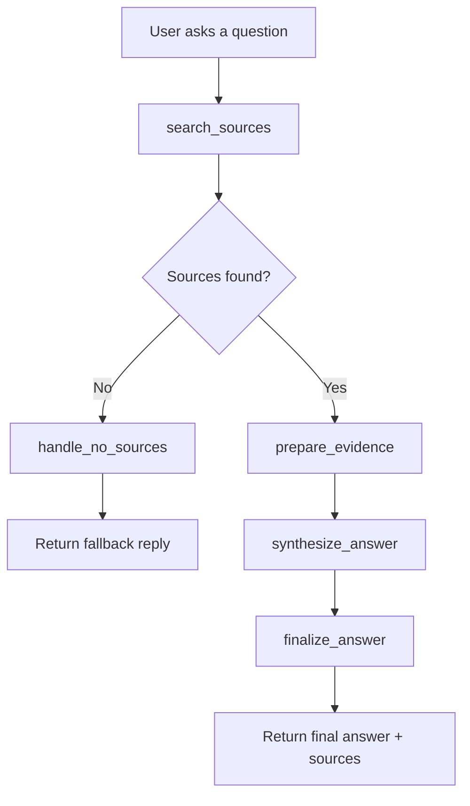
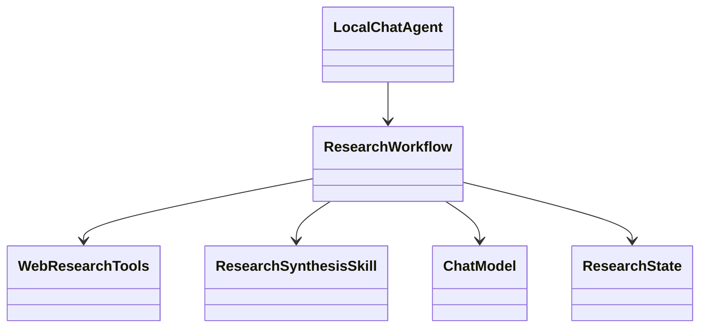
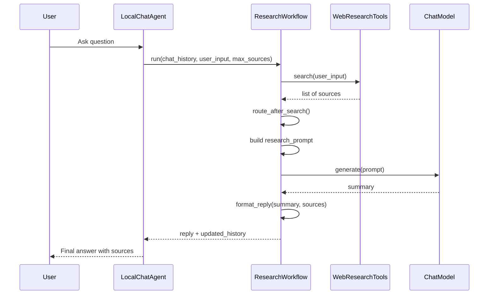

# 🕵️🌐 Simple Research Agent Workflow

## Build your first Agentic Workflow using langgraph, then see it operate like an AI Automation system.

A Python research agent that searches the public web, gathers evidence, synthesizes a concise answer, and returns source-backed results in a clean chat interface.

This project is designed as a practical, reproducible prototype for learning how to build an AI research workflow using LangGraph, tool-based retrieval, and model adapters. It emphasizes clarity over abstraction so the agent behavior, state transitions, and source handling remain easy to understand and extend.

## Why this project exists

This repo demonstrates a full research-agent loop:

- a user asks a question
- the agent searches public web sources
- it validates and extracts usable content
- it prepares evidence-backed prompts
- it asks a model for a summary
- it formats the final response with source links

It is ideal for experimentation, teaching, and extending into a more advanced multi-agent research system.

This project is agentic AI because it does more than generate text from a prompt: it executes a goal-driven workflow that searches the web, evaluates retrieved evidence, decides how to proceed based on runtime results, and uses external tools to complete a task. The agent maintains structured state across steps, routes through a graph of nodes and edges, and adapts its behavior depending on whether sources were found or a fallback response is required. In other words, the model is not just answering a question in isolation; it is acting as part of a system that gathers information, reasons over it, and produces a grounded response with source-backed citations.

## At a glance

- Python-first implementation
- LangGraph-driven workflow orchestration
- Streamlit interface for quick interaction
- Local or hosted model backend support
- Public-source research and extraction tools
- Developer-friendly architecture with explicit state and graph definitions

## Workflow overview



This is the runtime graph built with `StateGraph` in `src/first_agent/workflows/research.py`.

## Beginner-friendly: how the graph is built

The graph is intentionally simple and readable. Each node has one role, and each edge moves the workflow forward.

```python
builder = StateGraph(ResearchState)
builder.add_node("search_sources", self._search_sources)
builder.add_node("prepare_evidence", self._prepare_evidence)
builder.add_node("synthesize_answer", self._synthesize_answer)
builder.add_node("finalize_answer", self._finalize_answer)
builder.add_node("handle_no_sources", self._handle_no_sources)

builder.add_edge(START, "search_sources")
builder.add_conditional_edges(
    "search_sources",
    self._route_after_search,
    {"sources_found": "prepare_evidence", "no_sources": "handle_no_sources"},
)
builder.add_edge("prepare_evidence", "synthesize_answer")
builder.add_edge("synthesize_answer", "finalize_answer")
builder.add_edge("finalize_answer", END)
builder.add_edge("handle_no_sources", END)
```

### Nodes

- `search_sources`: searches the web and collects public sources
- `prepare_evidence`: converts the sources into a synthesis prompt
- `synthesize_answer`: asks the model to summarize the evidence
- `finalize_answer`: formats the final answer and appends sources
- `handle_no_sources`: returns a controlled fallback response when research fails

### State

The workflow state is defined in `src/first_agent/workflows/state.py`:

```python
class ResearchState(TypedDict):
    chat_history: list[ChatMessage]
    user_input: str
    max_new_tokens: int
    max_sources: int
    sources: list[ResearchSourceState]
    research_prompt: str
    summary: str
    reply: str
    updated_history: list[ChatMessage]
    error: NotRequired[str | None]
```

This state is retained across the graph run via LangGraph checkpoints and a thread-scoped config.

### Edges and conditional routing

The most important routing decision happens after `search_sources`:

```python
@staticmethod
def _route_after_search(state: ResearchState) -> str:
    return "sources_found" if state["sources"] else "no_sources"
```

If research returns sources, the workflow continues through the evidence and synthesis path. If not, it takes the fallback path and ends early with a user-friendly message.

## Technical architecture

### UML-style architecture overview



### Sequence diagram



## Project structure

```text
ai-agent-course/
├── apps/                         # Streamlit and future client interfaces
├── src/first_agent/
│   ├── agents/                   # Agent facades and composition logic
│   ├── workflows/                # LangGraph state, nodes, edges, and routing
│   ├── memory/                   # Short-term and long-term memory contracts
│   ├── skills/                   # Research and synthesis behaviors
│   ├── prompts/                  # Prompt assembly
│   ├── config/                   # Default configuration values
│   ├── models/                   # Provider-neutral model adapters
│   ├── tools/                    # Search and scraping tools
│   ├── agent.py                  # Backward-compatible public import
│   └── __init__.py
├── tests/                        # Deterministic unit and boundary tests
├── docs/                         # Architecture and operational guidance
├── logs/                         # Runtime and diagnostic logs
├── assets/                       # Static assets for future use
├── mcp/                          # Future MCP-related setup
├── skills/                       # Future reusable skill modules
├── tools/                        # Future standalone utility tools
├── first_agent.py                # Terminal entry point
├── requirements.txt
├── .env.example
├── README.md
├── audit_log.md
└── ...
```

## Setup

Create and activate a virtual environment:

```powershell
py -m venv .venv
.venv\Scripts\Activate.ps1
```

Install the project dependencies:

```powershell
pip install -r requirements.txt
```

For local GPU/CPU inference, install a compatible PyTorch build first if required:

```powershell
pip install torch --index-url https://download.pytorch.org/whl/cpu
```

Create a local environment file:

```powershell
copy .env.example .env
```

### Model backends

#### Local inference

```dotenv
CHAT_MODEL_BACKEND=local
HF_MODEL_ID=HuggingFaceTB/SmolLM2-360M-Instruct
```

#### Hosted inference

```dotenv
CHAT_MODEL_BACKEND=huggingface
HF_TOKEN=hf_replace_with_your_token
HF_INFERENCE_MODEL_ID=Qwen/Qwen2.5-7B-Instruct-1M
HF_INFERENCE_PROVIDER=featherless-ai
HF_INFERENCE_TIMEOUT=60
```

For hosted mode, keep `HF_TOKEN` out of version control. The secret should live in `.env` and should never be committed.

## Run

### Streamlit UI

```powershell
python -m streamlit run apps/streamlit_app.py --server.port=8503 --server.fileWatcherType=none
```

Then open:

```text
http://localhost:8503
```

### Terminal interface

```powershell
py first_agent.py
```

## Validation and reproducibility

```powershell
python -m unittest discover -s tests -v
python -m compileall first_agent.py apps src tests
git diff --check
```

These commands provide a reproducible baseline for verification. The project also includes deterministic tests covering model adapters, source retrieval, fallback behavior, routing, memory, and workflow boundaries.

## Reliability notes

- Search uses public web retrieval and safe URL validation
- Redirects and non-public destinations are rejected
- DNS and provider failures degrade to stable fallback responses
- Local models are useful for development, but hosted models generally produce stronger summary quality
- The project keeps orchestration, tools, prompts, and model adapters separately so they can be replaced independently

## Why it stands out

This project is more than a toy chatbot. It demonstrates a clean, practical architecture for building research-capable AI systems:

- explicit workflow graph instead of hidden orchestration
- modular tool boundaries instead of monolithic logic
- stateful execution with LangGraph checkpoints
- provider-neutral model adapters for future swap-in of different LLM backends
- production-minded safety checks around web access and private/public URL handling

## Future direction

The docs outline the next evolution toward FastAPI transport, MCP-style tools, and a more advanced multi-agent research system. The current repo focuses on establishing the core pattern clearly and reproducibly before scaling complexity.

## Final note

This project is intentionally simple enough to understand quickly, but structured enough to grow into a real research product. It is designed for learning, experimentation, and extension without sacrificing clarity or control.
